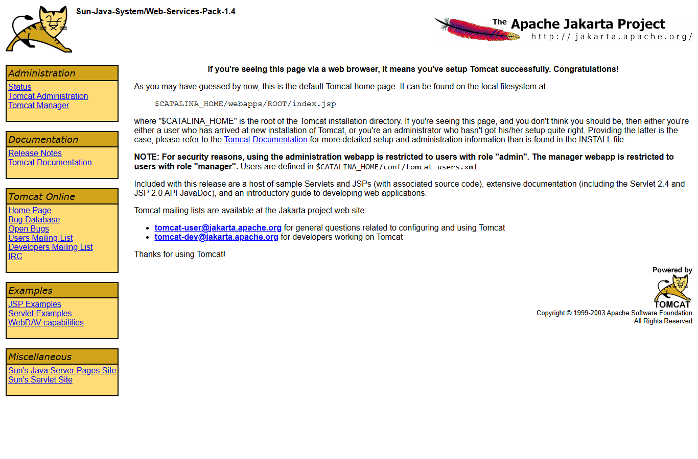
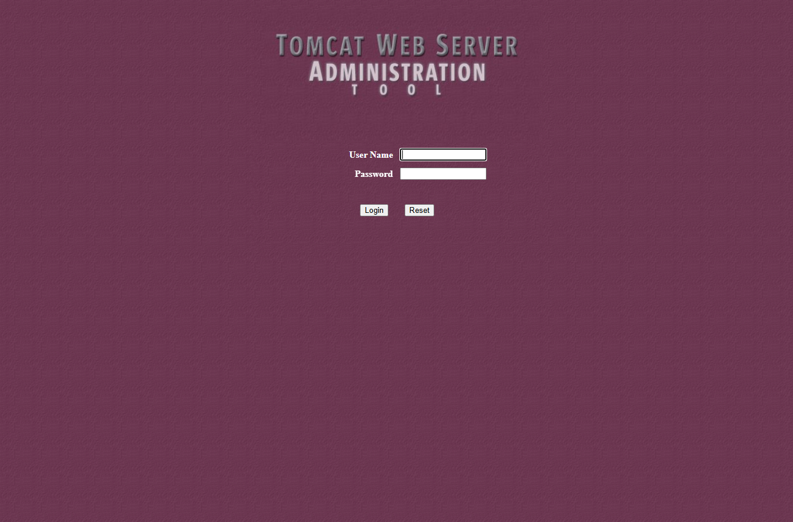
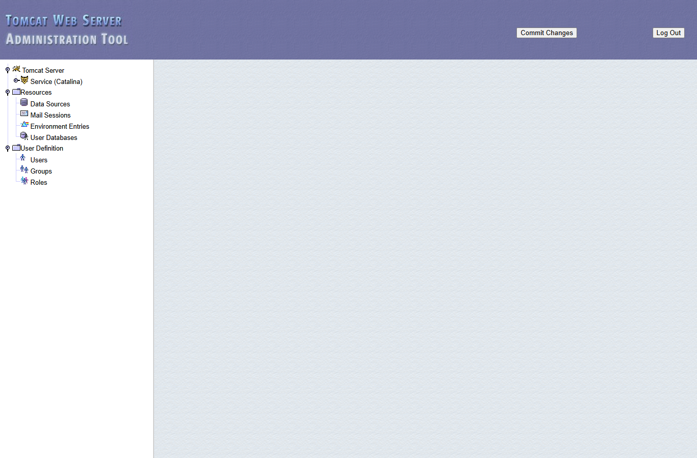
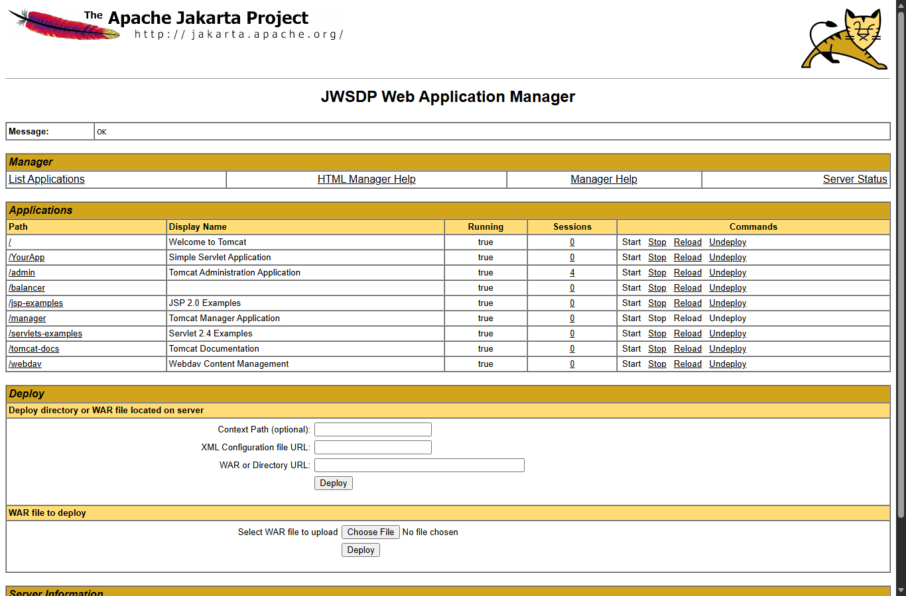
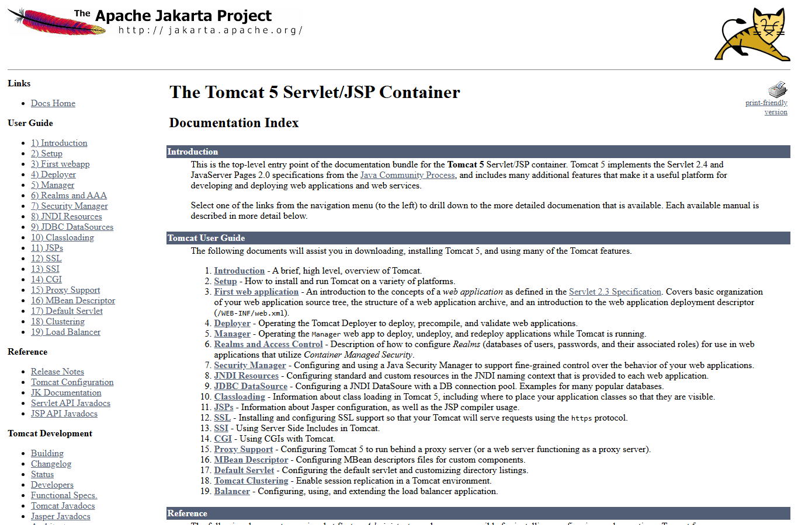
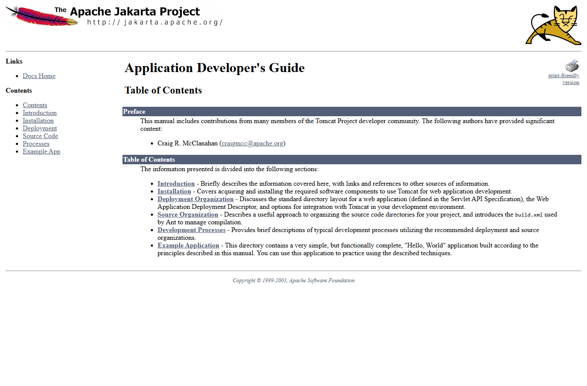
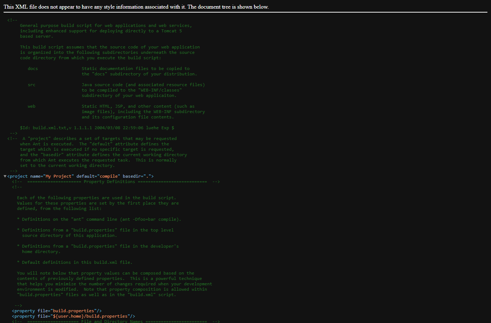
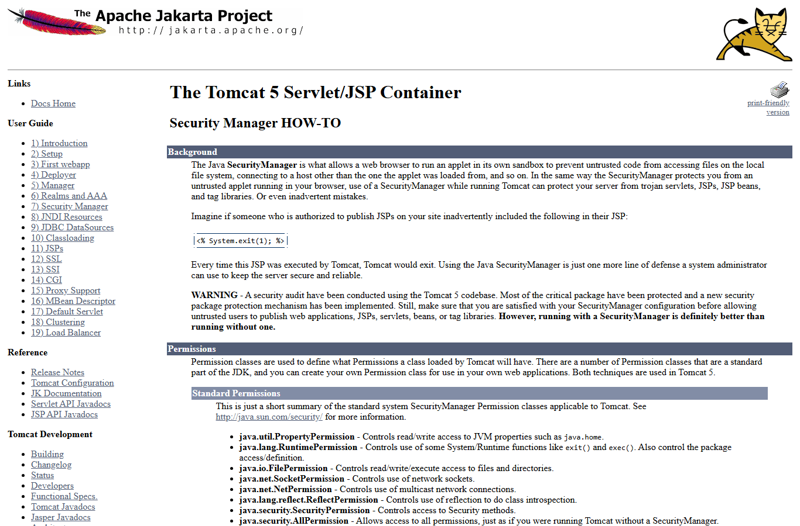
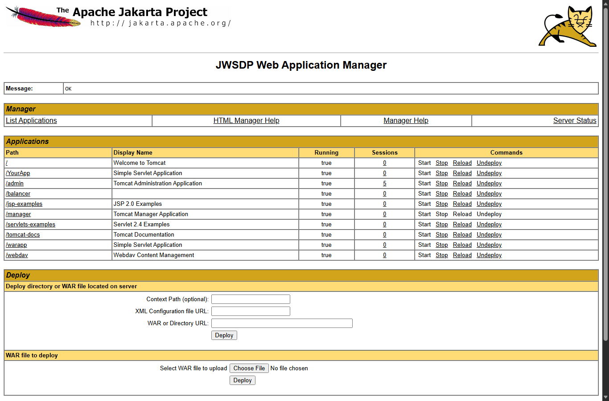

# Web Services Lab Practice 1

**GROUP NAME:** ______________________________

**GROUP MEMBERS NAME AND ID:**

| # | Name | ID |
|---|---|---|
| 1 | Bitanya Tigabe | 0248/15 |
| 2 | Mohammed Elias | 0766/15 |
| 3 | Awel Hussen | 0178/15 |
| 4 | Raeey Nega | 5307/16 |
| 5 | Hamdi Mohammes | 0505/15 |
| 6 | Heyru Jemal | 0546/15 |

**Course:** Web Services

**Date:** 25 October 2026

---

## Environment and Important Note

The lab guide uses:

- JDK 1.5
- Java Web Services Developer Pack (JWSDP) 2.0 / Tomcat 5
- `C:\tomcat50-jwsdp`
- `http://localhost:8080`

The provided `tomcat50-jwsdp.zip` identifies itself as **Sun-Java-System/Web-Services-Pack-1.4**; this is the Tomcat component bundle. The full JWSDP 2.0 installer, which contains the JAXR tools, was not used for the local server.

On this machine, port **8080 is already occupied by VMware NAT** (`vmnat.exe`). Therefore, the Tomcat HTTP connector was changed to **8081** and the local tests use:

- Tomcat: `C:\Users\raeey\AppData\Local\Temp\opencode\tomcat50\tomcat50-jwsdp`
- JDK 1.5.0_22 (64-bit): `C:\Users\raeey\AppData\Local\Temp\opencode\jdk15`
- URL: `http://localhost:8081`

The procedure and results are otherwise the same. On a lab machine, use port 8080 and the guide's `C:\tomcat50-jwsdp` path.

**Verification summary**

| Experiment | Status |
|---|---|
| 1. Install and start Tomcat | Done |
| 2-4. JAXR Registry Browser | Not executed; JWSDP installer requires elevation and the standalone Tomcat bundle does not contain JAXR/Registry Browser |
| 5. Tomcat home page | Done |
| 6. Tomcat Administration | Done |
| 7. Tomcat Manager | Done |
| 8. Tomcat Documentation | Done |
| 9. Application Developer's Guide | Done |
| 10. Sample `build.xml` | Done |
| 11. Security Manager | Read and summarized |
| 12. `server.xml` | Read and summarized |
| 13. Web application deployment and WAR | Done |
| 14. WebDAV | Done |
| 15. Apache Ant | Done |
| 16. Ant/servlet project | Done and deployed |

---

## Experiment 1: Install and Start Tomcat

### Aim

Install JDK 1.5 and Tomcat 5, start Tomcat, and identify the console output.

### Procedure

1. Installed JDK 1.5.0_22.
2. Set `JAVA_HOME` to the JDK directory.
3. Extracted `tomcat50-jwsdp.zip`.
4. Changed the HTTP connector from 8080 to 8081 because 8080 is occupied.
5. Started Tomcat with `bin\startup.bat`. During verification I used `bin\catalina.bat run` so that the startup log remained in the terminal.

### Observed console output

```text
Using CATALINA_BASE:   ..
Using CATALINA_HOME:   ..
Using CATALINA_TMPDIR: ..\temp
Using JAVA_HOME:       C:\Users\raeey\AppData\Local\Temp\opencode\jdk15
Oct 25, 2026 2:42:36 PM org.apache.coyote.http11.Http11Protocol init
INFO: Initializing Coyote HTTP/1.1 on port 8081
Oct 25, 2026 2:42:36 PM org.apache.catalina.startup.Catalina load
INFO: Initialization processed in 351 ms
Oct 25, 2026 2:42:36 PM org.apache.catalina.core.StandardService start
INFO: Starting service Catalina
Oct 25, 2026 2:42:36 PM org.apache.catalina.core.StandardEngine start
INFO: Starting Servlet Engine: Sun-Java-System/Web-Services-Pack-1.4
Oct 25, 2026 2:42:36 PM org.apache.catalina.core.StandardHost start
INFO: XML validation disabled
Oct 25, 2026 2:42:36 PM org.apache.catalina.core.StandardHost getDeployer
INFO: Create Host deployer for direct deployment ( non-jmx )
...
INFO: Installing web application at context path /tomcat-docs ...
INFO: Installing web application at context path /webdav ...
Oct 25, 2026 2:42:39 PM org.apache.coyote.http11.Http11Protocol start
INFO: Starting Coyote HTTP/1.1 on port 8081
Oct 25, 2026 2:42:39 PM org.apache.catalina.startup.Catalina start
INFO: Server startup in 2541 ms
```

### Explanation

The message `Server startup in 2541 ms` means Tomcat started successfully. Tomcat first creates the HTTP/1.1 connector, starts the Catalina service and servlet engine, deploys the web applications found in `webapps`, and then begins listening for HTTP requests. No startup error was reported.

Verification: `http://localhost:8081/` returned the Tomcat/JWSDP welcome page.

---

## Experiment 2: Browse the Registry Using the JAXR Registry Browser

### Aim

Use the JAXR Registry Browser to browse business providers registered in a UDDI registry.

### Procedure (as specified in the lab)

1. Start the JWSDP Registry Browser:
   `%JWSDP_HOME%\jaxr\bin\jaxr-browser.bat`
2. Select the configured UDDI registry and connect.
3. Expand the registry tree and open **Organizations**.
4. Select an organization and inspect its details.

### Expected observation

The Registry Browser is a Swing application. Its left side contains a registry/navigation tree and its right side displays the selected object. After connecting, the tree contains the registry root and categories such as **Organizations**, **Classification Schemes**, and **Service Bindings**. Selecting an organization displays its name, description, contacts, services, and service bindings.

### Result and limitation

This experiment could not be executed on this machine. The JWSDP 2.0 installer requires administrator elevation, and the standalone Tomcat 5 bundle used for the other experiments does not include the JAXR Registry Browser or a UDDI registry. The procedure and expected interface are therefore documented above; the actual provider list should be recorded from the lab registry.

**Lab record to complete:**

| Organization | Service | Binding/Endpoint |
|---|---|---|
|  |  |  |
|  |  |  |

---

## Experiment 3: Search the Registry

### Aim

Search the UDDI registry for a business or service and inspect the result.

### Procedure

1. Open the JAXR Registry Browser.
2. Connect to the registry.
3. Enter a business name or keyword in the search field, for example `Sun` or `web service`.
4. Run the search and select a result.
5. Expand the organization to view its services and service bindings.

### Expected observation

The search returns a table/list of matching organizations or services. Selecting a result shows its details in the right-hand pane. A service binding contains the access point (URL) and a description of the protocol.

### Result and limitation

Not executed for the same reason as Experiment 2: the Registry Browser/Registry Server is not part of the standalone Tomcat bundle, and the installer requires elevation.

---

## Experiment 4: Add an Organization to the Registry

### Aim

Create a new organization entry in the UDDI registry.

### Procedure

1. Connect the JAXR Registry Browser to the registry.
2. Choose the option to add/publish an organization.
3. Enter the organization name, description, and contact information.
4. Save the new organization.
5. Refresh the registry tree and verify that the organization appears.

### Expected observation

After saving, the new organization appears under **Organizations**. Opening it shows the entered name, description, and contacts. A registry key is generated for the new entry.

### Result and limitation

Not executed because no local UDDI registry/Registry Browser is installed. The report records the required procedure; the actual generated organization key should be copied from the lab registry.

---

## Experiment 5: Tomcat Home Page

### Aim

Open the Tomcat home page and identify the available links and status information.

### Procedure

Opened `http://localhost:8081/` in a browser.

### Observation



The page is the default Tomcat home page, branded **Sun-Java-System/Web-Services-Pack-1.4**. It contains:

- Administration
- Status
- Tomcat Administration
- Tomcat Manager
- Documentation: Release Notes, Tomcat Documentation
- Tomcat Online: Home Page, Bug Database, Open Bugs, Users Mailing List, Developers Mailing List, IRC
- Examples: JSP Examples, Servlet Examples, WebDAV capabilities
- Miscellaneous: Sun's Java Server Pages Site, Sun's Servlet Site

The main message is:

> If you're seeing this page via a web browser, it means you've setup Tomcat successfully. Congratulations!

The page also explains that the administration web application is restricted to users with role `admin` and the manager web application to users with role `manager`. Users are defined in `conf/tomcat-users.xml`.

### Conclusion

Tomcat is installed and serving requests correctly. The home page confirms the server version/branding and provides entry points to the administration, manager, documentation, and example applications.

---

## Experiment 6: Tomcat Administration Application

### Aim

Open the Tomcat Administration application, log in, and inspect the server configuration tree.

### Procedure

1. Added an administrative user to `conf/tomcat-users.xml`:

```xml
<user username="admin" password="admin" roles="admin,manager"/>
```

2. Opened `http://localhost:8081/admin`.
3. Logged in with username `admin` and password `admin`.
4. Inspected the left-hand navigation tree and the right-hand content area.

### Observation



After login, the application displays a frameset:

- Top banner: **Tomcat Server Administration**
- Left frame: configuration tree
- Right frame: content editor



The visible tree contains:

```text
Tomcat Server
  Service (Catalina)
    Resources
      Data Sources
      Mail Sessions
      Environment Entries
      User Databases
      User Definition
        Users
        Groups
        Roles
```

Selecting a node opens its editor in the right-hand frame. This application is used to view and modify Tomcat configuration such as data sources, mail sessions, environment entries, and users/roles.

### Note

The bundled administration application is very old. When expanding some JMX-backed nodes, the Tomcat log recorded:

```text
javax.management.AttributeNotFoundException: Cannot find attribute className
    at org.apache.webapp.admin.TomcatTreeBuilder.getValves(...)
```

This is a compatibility issue in the legacy admin application; it does not prevent Tomcat from starting or serving the lab applications. The main administration tree and login work.

### Conclusion

The administration application is protected by form-based authentication. Only a user with the `admin` role can log in. The tree provides centralized access to Tomcat resources and user management.

---

## Experiment 7: Tomcat Manager

### Aim

Open the Tomcat Manager, authenticate, list deployed applications, and inspect their status.

### Procedure

1. Opened `http://localhost:8081/manager/html`.
2. Authenticated with username `admin` and password `admin`.
3. Inspected the application list and server information.

### Observation



The manager displays:

- **Message:** OK
- Links: List Applications, HTML Manager Help, Manager Help, Server Status
- A table of applications with columns: Path, Display Name, Running, Sessions, Commands
- Commands: Start, Stop, Reload, Undeploy
- A deploy section for a directory/WAR on the server or an uploaded WAR file
- Server Information

The application list included:

```text
/                  Welcome to Tomcat
/YourApp           Simple Servlet Application
/admin             Tomcat Administration Application
/balancer
/jsp-examples      JSP 2.0 Examples
/manager           Tomcat Manager Application
/servlets-examples Servlet 2.4 Examples
/tomcat-docs       Tomcat Documentation
/webdav            Webdav Content Management
```

Later, after the WAR from Experiment 13 was deployed, the manager also listed:

```text
/warapp            Simple Servlet Application
```

Server information observed:

```text
JWSDP Version : Sun-Java-System/Web-Services-Pack-1.4
JVM Version   : 1.5.0_22-b03
JVM Vendor    : Sun Microsystems Inc.
OS Name       : Windows NT (unknown)
OS Version    : 6.2
OS Architecture: amd64
```

### Explanation

The Manager is a web application that lets an administrator deploy, start, stop, reload, and undeploy applications without editing configuration files manually. It uses HTTP Basic authentication and requires the `manager` role. The `admin` user created for this lab has both `admin` and `manager` roles, so it can access both the Administration and Manager applications.

---

## Experiment 8: Tomcat Documentation

### Aim

Browse the local Tomcat documentation and list its main contents.

### Procedure

Opened `http://localhost:8081/tomcat-docs/`.

### Observation



The documentation index identifies the server as **The Tomcat 5 Servlet/JSP Container** and states that Tomcat 5 implements Servlet 2.4 and JSP 2.0.

The user guide contains:

1. Introduction
2. Setup
3. First web application
4. Deployer
5. Manager
6. Realms and AAA
7. Security Manager
8. JNDI Resources
9. JDBC DataSources
10. Classloading
11. JSPs
12. SSL
13. SSI
14. CGI
15. Proxy Support
16. MBean Descriptor
17. Default Servlet
18. Clustering
19. Load Balancer

Reference material includes release notes, Tomcat configuration, JK documentation, Servlet API Javadocs, JSP API Javadocs, building instructions, changelog, status, developer documentation, functional specifications, Tomcat Javadocs, Jasper Javadocs, and architecture.

### Conclusion

The local documentation is a complete offline copy of the Tomcat 5 documentation. It is useful for configuring the container and for understanding deployment, security, JDBC, JNDI, and clustering.

---

## Experiment 9: Application Developer's Guide

### Aim

Open the Application Developer's Guide and identify the topics covered.

### Procedure

Opened `http://localhost:8081/tomcat-docs/appdev/index.html`.

### Observation



The guide contains:

- Preface
- Introduction
- Installation
- Deployment Organization
- Source Organization
- Development Processes
- Example Application

It explains the standard web application directory layout, the deployment descriptor (`WEB-INF/web.xml`), a recommended source directory structure, and the use of Ant's `build.xml`. The example application is a simple "Hello, World" application built using these conventions.

### Conclusion

The guide describes how to organize, compile, package, and deploy a web application. The key idea is to separate source code, web content, and build output, and to use a build tool to assemble the deployable web application.

---

## Experiment 10: Sample `build.xml`

### Aim

Read the sample Ant build file supplied with Tomcat and understand its targets.

### Procedure

Opened `http://localhost:8081/tomcat-docs/appdev/sample/build.xml`.

### Observation



The sample is a general-purpose Ant build script for web applications and web services. Its source layout is:

```text
docs/   static documentation
src/    Java source and resources
web/    HTML, JSP, images, WEB-INF/web.xml
```

Important properties include:

```xml
<property name="app.name"      value="myapp"/>
<property name="app.path"      value="/${app.name}"/>
<property name="app.version"   value="0.1-dev"/>
<property name="build.home"    value="${basedir}/build"/>
<property name="catalina.home" value="../../../.."/> <!-- UPDATE THIS! -->
<property name="dist.home"     value="${basedir}/dist"/>
<property name="src.home"      value="${basedir}/src"/>
<property name="web.home"      value="${basedir}/web"/>
```

The script defines Ant tasks for the Tomcat Manager:

```xml
<taskdef name="deploy"   classname="org.apache.catalina.ant.DeployTask"/>
<taskdef name="list"     classname="org.apache.catalina.ant.ListTask"/>
<taskdef name="reload"   classname="org.apache.catalina.ant.ReloadTask"/>
<taskdef name="undeploy" classname="org.apache.catalina.ant.UndeployTask"/>
```

To use those tasks, `server/lib/catalina-ant.jar` must be copied into Ant's `lib` directory, and a `build.properties` file must define `manager.url`, `manager.username`, and `manager.password`.

Targets:

| Target | Purpose |
|---|---|
| `all` | Clean, then compile |
| `clean` | Delete `build` and `dist` |
| `compile` | Compile `src` into `build/WEB-INF/classes` and copy resources |
| `dist` | Create the WAR and copy documentation |
| `install` | Deploy the application through the Manager |
| `javadoc` | Generate API documentation |
| `list` | List installed applications through the Manager |
| `prepare` | Create the build directory and copy static web content |
| `reload` | Reload the deployed application |
| `remove` | Undeploy the application |

### Conclusion

The sample build file is a reusable template. Before using it, update `catalina.home`, set the manager credentials, and make sure `catalina-ant.jar` is available to Ant.

---

## Experiment 11: Security Manager

### Aim

Read the Security Manager HOW-TO and understand how Tomcat can be run with a Java Security Manager.

### Procedure

Opened `http://localhost:8081/tomcat-docs/security-manager-howto.html`.

### Observation



The Security Manager is the Java mechanism that restricts what code is allowed to do. When Tomcat runs with a Security Manager, a malicious or accidental servlet/JSP cannot freely read files, open network connections, call `System.exit()`, or execute external programs.

Tomcat uses the standard Java permission classes, including:

- `java.util.PropertyPermission`
- `java.lang.RuntimePermission`
- `java.io.FilePermission`
- `java.net.SocketPermission`
- `java.net.NetPermission`
- `java.lang.reflect.ReflectPermission`
- `java.security.SecurityPermission`
- `java.security.AllPermission`

It also uses the custom `org.apache.naming.JndiPermission` for JNDI file-based resources.

The policy is configured in:

```text
$CATALINA_HOME/conf/catalina.policy
```

The file uses the standard Java policy syntax:

```java
grant [signedBy <signer>,] [codeBase <code source>] {
    permission <class> [<name> [, <action list>]];
};
```

The default policy grants all permissions to the JDK extensions, the Tomcat bootstrap/launcher, `common`, and `server` code. Web applications receive a limited set of permissions plus read access to their own document root.

Tomcat is started with the Security Manager by adding `-security`:

```bat
bin\startup.bat -security
```

or:

```bat
bin\catalina.bat run -security
```

### Conclusion

The Security Manager adds a layer of protection around deployed web applications. It is configured with `catalina.policy`, and the policy must grant enough permissions for the application to work. It was not enabled for the main lab server because the other experiments were run with the normal startup; enabling it requires a compatible policy and testing. The procedure and configuration above are the documented way to enable it.

---

## Experiment 12: `server.xml`

### Aim

Read and explain the main elements of `conf/server.xml`.

### Observation

The main structure is:

```xml
<Server port="8005" shutdown="SHUTDOWN" debug="0">
  <Listener className="org.apache.catalina.mbeans.ServerLifecycleListener"/>
  <Listener className="org.apache.catalina.mbeans.GlobalResourcesLifecycleListener"/>

  <GlobalNamingResources>
    <Environment name="simpleValue" type="java.lang.Integer" value="30"/>
    <Resource name="UserDatabase" auth="Container"
              type="org.apache.catalina.UserDatabase" .../>
  </GlobalNamingResources>

  <Service name="Catalina">
    <Connector port="8081" .../>
    <Engine name="Catalina" defaultHost="localhost" debug="0">
      <Valve className="org.apache.catalina.valves.AccessLogValve" .../>
      <Logger className="org.apache.catalina.logger.FileLogger" .../>
      <Realm className="org.apache.catalina.realm.UserDatabaseRealm"
             resourceName="UserDatabase"/>
      <Host name="localhost" appBase="webapps"
            unpackWARs="false" autoDeploy="true"
            xmlValidation="false" xmlNamespaceAware="false">
        ...
      </Host>
    </Engine>
  </Service>
</Server>
```

The connector port was changed from 8080 to 8081 for this machine. The lab guide's original value is 8080.

### Explanation of the elements

| Element | Meaning |
|---|---|
| `Server` | The top-level Tomcat server. It listens on port 8005 for the shutdown command. |
| `Listener` | Registers lifecycle listeners, including JMX/MBean support. |
| `GlobalNamingResources` | Defines JNDI resources available to all applications. The `UserDatabase` resource points to `conf/tomcat-users.xml`. |
| `Service` | Groups one or more connectors with one engine. |
| `Connector` | The HTTP/1.1 endpoint. It listens on port 8081, accepts requests, and passes them to the engine. |
| `Engine` | The top-level request-processing container. `defaultHost="localhost"` selects the default virtual host. |
| `Valve` | A request-processing component. `AccessLogValve` writes access logs. |
| `Logger` | Writes Tomcat log messages. |
| `Realm` | The user/role database used for authentication. `UserDatabaseRealm` reads users from `tomcat-users.xml`. |
| `Host` | A virtual host. `appBase="webapps"` means applications are deployed from the `webapps` directory. `autoDeploy="true"` makes Tomcat detect new applications and WAR files. `unpackWARs="false"` means WAR files can be served without being expanded into directories. |

### Conclusion

`server.xml` is the main Tomcat configuration file. It defines the server shutdown port, network connector, engine, virtual host, application base directory, logging, and authentication realm.

---

## Experiment 13: Web Applications, `WEB-INF`, and WAR Deployment

### Aim

Inspect the deployed web applications, explain the purpose of `WEB-INF`, create a WAR file, and deploy it.

### Deployed applications

The `webapps` directory contained:

```text
ROOT
admin
balancer
jsp-examples
manager
servlets-examples
tomcat-docs
webdav
YourApp
```

The Manager listed these as running applications. Each directory is a web application with a context path equal to its directory name, except `ROOT`, which is the root context `/`.

### Purpose of `WEB-INF`

`WEB-INF` is the private configuration and class directory of a web application. It is not directly accessible to browser clients. It contains:

```text
WEB-INF/
  web.xml          deployment descriptor
  classes/         compiled servlet and helper classes
  lib/             JAR libraries used by the application
```

The servlet container uses `web.xml` to map URLs to servlets, define filters/listeners, set welcome files, and configure security. Because `WEB-INF` is protected, a request such as `http://localhost:8081/warapp/WEB-INF/web.xml` returns **404 Not Found** instead of exposing the descriptor.

### Creating a WAR

The compiled Experiment 16 application was packaged with the JDK 1.5 `jar` tool:

```bat
jar cf dist\YourApp.war -C build .
```

The resulting WAR had this structure:

```text
YourApp.war
  com/example/MyServlet.class
  WEB-INF/web.xml
  WEB-INF/classes/com/example/MyServlet.class
```

The WAR was copied into Tomcat's `webapps` directory as `warapp.war`. Because `autoDeploy="true"`, Tomcat detected it and deployed it at context path `/warapp`.

### Observation

```text
http://localhost:8081/warapp/hello
-> 200 OK
-> Hello from MyServlet!

http://localhost:8081/warapp/WEB-INF/web.xml
-> 404 Not Found
```

The Manager also showed:

```text
/warapp:running:0:...\webapps\warapp.war
```



### Conclusion

A web application can be deployed as an unpacked directory or as a WAR file. `WEB-INF` holds private deployment information and classes, and the container prevents clients from reading it directly. Tomcat's `autoDeploy` feature detected the new WAR and deployed it without restarting the server.

---

## Experiment 14: WebDAV

### Aim

Inspect the WebDAV web application and its `web.xml`, then test WebDAV access.

### Observation

The WebDAV deployment descriptor is:

```xml
<web-app>
  <display-name>Webdav Content Management</display-name>

  <servlet>
    <servlet-name>webdav</servlet-name>
    <servlet-class>org.apache.catalina.servlets.WebdavServlet</servlet-class>
    <init-param>
      <param-name>debug</param-name>
      <param-value>0</param-value>
    </init-param>
    <init-param>
      <param-name>listings</param-name>
      <param-value>true</param-value>
    </init-param>
    <!-- Uncomment this to enable read and write access -->
<!--
    <init-param>
      <param-name>readonly</param-name>
      <param-value>false</param-value>
    </init-param>
-->
  </servlet>

  <servlet-mapping>
    <servlet-name>webdav</servlet-name>
    <url-pattern>/*</url-pattern>
  </servlet-mapping>
</web-app>
```

The security constraint and `BASIC` login configuration are commented out by default.

Testing with `OPTIONS` produced:

```text
HTTP/1.1 200 OK
DAV: 1,2
Allow: OPTIONS, GET, HEAD, POST, DELETE, TRACE, PROPPATCH, COPY, MOVE, LOCK, UNLOCK, PROPFIND
MS-Author-Via: DAV
```

A write test with `PUT` produced:

```text
HTTP/1.1 403 Forbidden
```

### Explanation

WebDAV (Web Distributed Authoring and Versioning) is an extension of HTTP that allows clients to manage files on a remote server: create, read, move, copy, lock, unlock, and delete resources. Tomcat provides this through `WebdavServlet`, mapped to `/*` in the `/webdav` application.

Because the `readonly=false` parameter is commented out, the default read-only behavior is used. That is why `OPTIONS` advertises DAV support but `PUT` is rejected with **403 Forbidden**. To allow writing, uncomment the `readonly` parameter with value `false` and restart Tomcat.

### Conclusion

The WebDAV application is deployed at `/webdav`. It supports DAV level 1 and 2 and is read-only by default. Read/write access must be enabled explicitly in `WEB-INF/web.xml`.

---

## Experiment 15: Apache Ant

### Aim

Install Apache Ant, verify the installation, and use it to build a web application.

### Procedure

1. Obtained Apache Ant 1.7.1. This version runs on JDK 1.5 and supports the `includeantruntime` attribute used in the build file. The Ant JARs were placed in a local `ant171` directory and invoked with a small `ant.bat` launcher.
2. Set `JAVA_HOME` to the JDK 1.5 directory.
3. Added the Ant launcher to the command path and verified the installation with `ant -version`.

### Observed output

```text
Apache Ant version 1.7.1 compiled on June 27 2008
```

A build of the Experiment 16 project produced:

```text
Buildfile: build.xml

clean:
   [delete] Deleting directory ...\Experiment16\build

compile:
    [mkdir] Created dir: ...\Experiment16\build
    [javac] Compiling 1 source file to ...\Experiment16\build

prepare:
    [mkdir] Created dir: ...\Experiment16\build\WEB-INF\classes
     [copy] Copying 1 file to ...\Experiment16\build\WEB-INF\classes
     [copy] Copying 1 file to ...\Experiment16\build\WEB-INF

deploy:
    [mkdir] Created dir: ...\tomcat50-jwsdp\webapps\YourApp
     [copy] Copying 3 files to ...\tomcat50-jwsdp\webapps\YourApp
     [echo] Servlet deployed to ...\webapps\YourApp. Restart Tomcat to apply changes.

BUILD SUCCESSFUL
Total time: 0 seconds
```

### Explanation

Ant is a Java-based build tool. A `build.xml` file contains:

- A **project** with a name, default target, and base directory
- **Properties** that hold paths and configuration values
- **Targets** that describe build steps
- **Tasks** such as `javac`, `copy`, `mkdir`, `jar`, and `delete`

The `compile` target compiles the servlet, `prepare` assembles the `WEB-INF` structure, and `deploy` copies the result into Tomcat's `webapps` directory.

### Note

Tomcat's bundled Ant 1.5.2 is too old for the `includeantruntime` attribute. Ant 1.7.1 was used instead. If a lab machine provides Ant 1.6.5 or newer, the same build file works.

### Conclusion

Ant automates compilation, packaging, and deployment. Once `build.xml` is configured, a single command produces a deployable web application.

---

## Experiment 16: Ant Build File, Servlet, and Deployment

### Aim

Create a servlet web application with a `build.xml` file, compile it with Ant, deploy it to Tomcat, and verify it in a browser.

### Project location

```text
C:\Users\raeey\Desktop\web service\Experiment16\
  build.xml
  src\com\example\MyServlet.java
  web\WEB-INF\web.xml
  build\                  (generated)
  dist\YourApp.war        (generated)
```

### Servlet: `src\com\example\MyServlet.java`

```java
/*
  GROUP NAME: ______________________________
  GROUP MEMBERS NAME AND ID:
    1. Bitanya Tigabe              (ID: 0248/15)
    2. Mohammed Elias              (ID: 0766/15)
    3. Awel Hussen                 (ID: 0178/15)
    4. Raeey Nega                  (ID: 5307/16)
    5. Hamdi Mohammes              (ID: 0505/15)
    6. Heyru Jemal                 (ID: 0546/15)
  Title of the program: MyServlet - a simple HTTP servlet used in
                         Experiment 16 (Ant compile and Tomcat deployment)
  Output (compilation): Compiles successfully; when requested, the servlet
                         returns "Hello from MyServlet!"
*/
package com.example;

import java.io.IOException;
import javax.servlet.ServletException;
import javax.servlet.http.*;

public class MyServlet extends HttpServlet {
    @Override
    protected void doGet(HttpServletRequest req, HttpServletResponse resp)
            throws ServletException, IOException {
        resp.setContentType("text/plain");
        resp.getWriter().println("Hello from MyServlet!");
    }
}
```

### Deployment descriptor: `web\WEB-INF\web.xml`

```xml
<?xml version="1.0" encoding="UTF-8"?>
<!--
  GROUP NAME: ______________________________
  GROUP MEMBERS NAME AND ID:
    1. Bitanya Tigabe              (ID: 0248/15)
    2. Mohammed Elias              (ID: 0766/15)
    3. Awel Hussen                 (ID: 0178/15)
    4. Raeey Nega                  (ID: 5307/16)
    5. Hamdi Mohammes              (ID: 0505/15)
    6. Heyru Jemal                 (ID: 0546/15)
  Title of the program: Deployment descriptor for MyServlet (Experiment 16)
  Output (compilation): Parsed and deployed successfully by Tomcat 5
-->
<web-app xmlns="http://java.sun.com/xml/ns/j2ee"
         xmlns:xsi="http://www.w3.org/2001/XMLSchema-instance"
         xsi:schemaLocation="http://java.sun.com/xml/ns/j2ee
                             http://java.sun.com/xml/ns/j2ee/web-app_2_4.xsd"
         version="2.4">

    <display-name>Simple Servlet Application</display-name>

    <servlet>
        <servlet-name>MyServlet</servlet-name>
        <servlet-class>com.example.MyServlet</servlet-class>
    </servlet>

    <servlet-mapping>
        <servlet-name>MyServlet</servlet-name>
        <url-pattern>/hello</url-pattern>
    </servlet-mapping>

</web-app>
```

### Build file: `build.xml`

```xml
<?xml version="1.0" encoding="UTF-8"?>
<!--
  GROUP NAME: ______________________________
  GROUP MEMBERS NAME AND ID:
    1. Bitanya Tigabe              (ID: 0248/15)
    2. Mohammed Elias              (ID: 0766/15)
    3. Awel Hussen                 (ID: 0178/15)
    4. Raeey Nega                  (ID: 5307/16)
    5. Hamdi Mohammes              (ID: 0505/15)
    6. Heyru Jemal                 (ID: 0546/15)
  Title of the program: Experiment 16 - Apache Ant build file that compiles
                         a servlet and deploys it to Tomcat 5
  Output (compilation): BUILD SUCCESSFUL; servlet deployed to
                         ${tomcat.home}/webapps/YourApp
-->
<project name="SimpleServletBuild" default="deploy" basedir=".">
    <property name="src.dir" value="src"/>
    <property name="build.dir" value="build"/>
    <property name="web.dir" value="web"/>
    <property name="tomcat.home" value="C:/tomcat50-jwsdp"/>
    <property name="deploy.dir" value="${tomcat.home}/webapps/YourApp"/>

    <path id="compile.classpath">
        <pathelement location="${tomcat.home}/common/lib/servlet-api.jar"/>
    </path>

    <target name="clean">
        <delete dir="${build.dir}"/>
    </target>

    <target name="compile" depends="clean">
        <mkdir dir="${build.dir}"/>
        <javac srcdir="${src.dir}" destdir="${build.dir}" includeantruntime="false"
               classpathref="compile.classpath"/>
    </target>

    <target name="prepare" depends="compile">
        <mkdir dir="${build.dir}/WEB-INF/classes"/>
        <copy todir="${build.dir}/WEB-INF/classes">
            <fileset dir="${build.dir}"/>
        </copy>
        <copy todir="${build.dir}/WEB-INF">
            <fileset dir="${web.dir}/WEB-INF"/>
        </copy>
    </target>

    <target name="deploy" depends="prepare">
        <mkdir dir="${deploy.dir}"/>
        <copy todir="${deploy.dir}">
            <fileset dir="${build.dir}"/>
        </copy>
        <echo message="Servlet deployed to ${deploy.dir}. Restart Tomcat to apply changes."/>
    </target>
</project>
```

### Build and deployment command

On this machine `tomcat.home` was overridden so that Ant deployed to the test Tomcat:

```bat
java -cp "ant-1.7.1.jar;ant-launcher-1.7.1.jar;%JAVA_HOME%\lib\tools.jar" ^
     org.apache.tools.ant.Main -f build.xml ^
     -Dtomcat.home=C:/Users/raeey/AppData/Local/Temp/opencode/tomcat50/tomcat50-jwsdp ^
     deploy
```

A normal Ant installation uses the shorter form:

```bat
ant -Dtomcat.home=C:/tomcat50-jwsdp deploy
```

### Build output

```text
Buildfile: build.xml

clean:
   [delete] Deleting directory ...\Experiment16\build

compile:
    [mkdir] Created dir: ...\Experiment16\build
    [javac] Compiling 1 source file to ...\Experiment16\build

prepare:
    [mkdir] Created dir: ...\Experiment16\build\WEB-INF\classes
     [copy] Copying 1 file to ...\Experiment16\build\WEB-INF\classes
     [copy] Copying 1 file to ...\Experiment16\build\WEB-INF

deploy:
    [mkdir] Created dir: ...\tomcat50-jwsdp\webapps\YourApp
     [copy] Copying 3 files to ...\tomcat50-jwsdp\webapps\YourApp
     [echo] Servlet deployed to ...\webapps\YourApp. Restart Tomcat to apply changes.

BUILD SUCCESSFUL
Total time: 0 seconds
```

Although the build file's message says to restart Tomcat, the server had `autoDeploy="true"`, so it detected the new `YourApp` directory automatically. A restart is only required if automatic deployment is disabled.

### Verification


```text
Request:  http://localhost:8081/YourApp/hello
Response: 200 OK
Body:     Hello from MyServlet!
```

The deployed application structure was:

```text
webapps\YourApp\
  com\example\MyServlet.class
  WEB-INF\
    web.xml
    classes\
      com\example\MyServlet.class
```

The compiled class had major version 49, which is Java 5 bytecode and is loadable by Tomcat running on JDK 1.5.

Note: the guide's `prepare` task copies the whole build directory into `WEB-INF/classes`, so the class appears both at the application root and under `WEB-INF/classes`. Only the `WEB-INF/classes` copy is used by the servlet container; the root copy is redundant. It can be avoided by compiling directly into `WEB-INF/classes`.

The Manager also listed `/YourApp` as a running application. The same compiled output was packaged as `dist\YourApp.war` and successfully deployed at `/warapp`, confirming that the WAR contents are valid.

### Explanation of the build targets

| Target | Action |
|---|---|
| `clean` | Deletes the old `build` directory so the next build starts fresh. |
| `compile` | Creates `build` and compiles all `.java` files from `src` using `servlet-api.jar` from Tomcat. |
| `prepare` | Creates `WEB-INF/classes`, copies the compiled classes into it, and copies `web/WEB-INF/web.xml` into the build output. |
| `deploy` | Copies the assembled build directory to `${tomcat.home}/webapps/YourApp`. Tomcat's `autoDeploy` detects the new directory. |

### Why `servlet-api.jar` is on the classpath

`MyServlet` extends `HttpServlet`, which is part of the Servlet API. The Servlet API is not part of the standard JDK. Tomcat provides it in:

```text
common\lib\servlet-api.jar
```

The build file adds that JAR to the compile classpath.

### How Tomcat maps the request

`web.xml` maps the URL pattern `/hello` to the servlet class `com.example.MyServlet`. Therefore:

```text
http://localhost:8081/YourApp/hello
```

causes Tomcat to call `MyServlet.doGet()`, which sets the content type to `text/plain` and writes:

```text
Hello from MyServlet!
```

### Conclusion

The experiment successfully demonstrated a complete Ant-based servlet workflow:

1. Write the servlet and deployment descriptor.
2. Compile the servlet with Ant against Tomcat's Servlet API.
3. Assemble the `WEB-INF` structure.
4. Deploy the application to Tomcat's `webapps` directory.
5. Access the servlet through a browser and receive the expected response.

The same project was also packaged as a WAR and deployed successfully, which confirms that the build output is a valid Java web application.

---

## Overall Conclusion

This lab introduced the JWSDP/Tomcat environment, the Tomcat Administration and Manager applications, local documentation, web application structure, `WEB-INF`, WAR deployment, WebDAV, the Java Security Manager, `server.xml` configuration, Apache Ant, and servlet deployment.

The most important practical result is that a servlet application can be built and deployed entirely from the command line:

```text
src + web/WEB-INF/web.xml
        |
        |  ant deploy
        v
build/WEB-INF/classes + web.xml
        |
        |  copy to Tomcat webapps
        v
http://localhost:8080/YourApp/hello
```

The experiments that require the full JWSDP 2.0 Registry Browser (2-4) could not be run in this environment because the installer requires administrator elevation and the standalone Tomcat bundle does not include JAXR/UDDI. The remaining experiments were performed against the running Tomcat 5/JWSDP instance, and the reported outputs and screenshots are from that instance.
